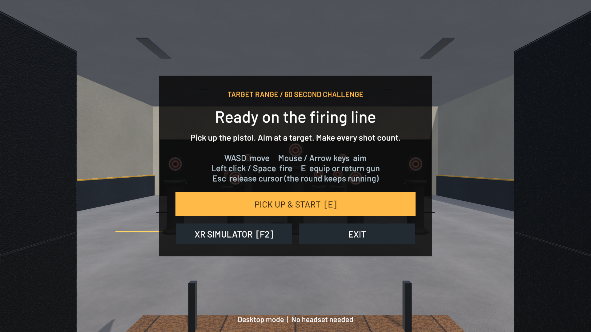
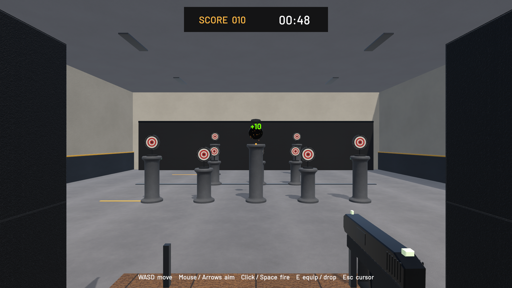
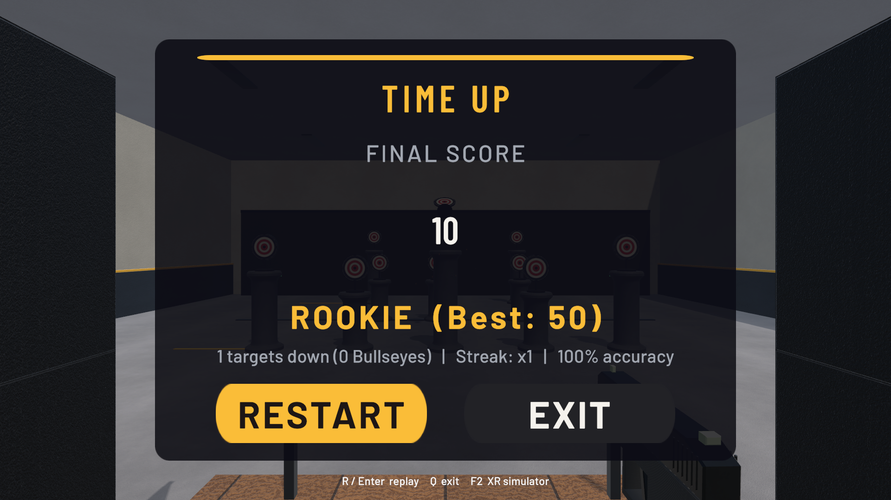
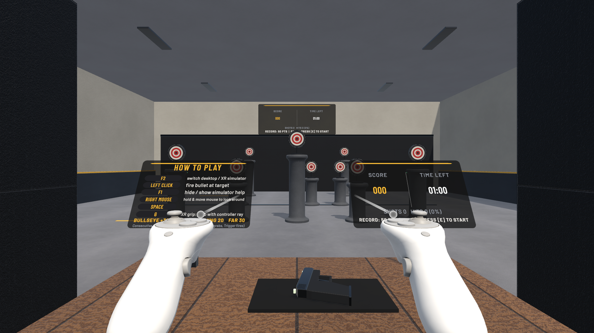
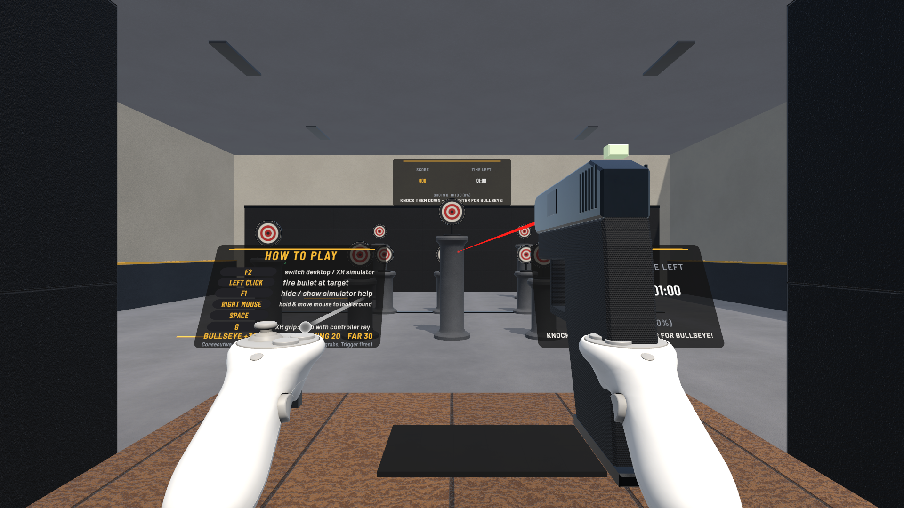
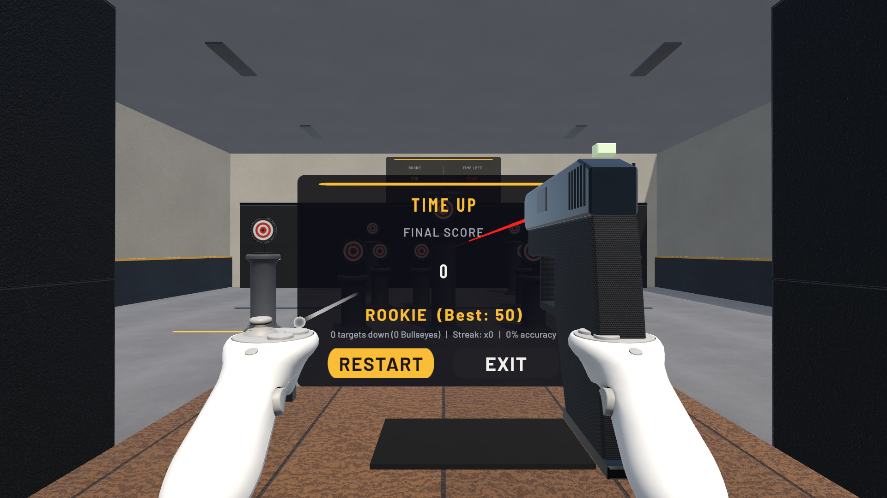

# Task 2 - Target Range XR

## Open the delivered ZIP - updated 2 November 2026

Extract the **entire ZIP** to a short local folder such as `C:\UnityAssignment`. The combined ZIP contains separate `Task1` and `Task2` project folders. Do not run from inside the ZIP.

- **Play without Unity:** double-click `PLAY.cmd` inside this task folder. It finds the bundled Windows player relative to itself, even if the folder is moved. Keep the complete `Builds/Windows` folder, including its `_Data` folder and `UnityPlayer.dll`.
- **Install:** use the setup EXE in `Installer`; this is an alternative to the portable player.
- **Edit source:** Unity Hub > Add project from disk > choose this task folder containing `Assets`, `Packages`, and `ProjectSettings`. Use **6000.6.7f1** with an activated Editor license. First import needs internet to restore registry packages. Open the supplied scene; do not regenerate it.
- **Watch locally:** the owner-provided MP4 is in `Docs`. No YouTube or Google Drive access is required after downloading this ZIP.
- **Diagnose a launch problem:** `PLAY.cmd` writes the player log to `%TEMP%/Task2-Player.log`. Report the first error and the exact action that failed.

A Unity shooting range with an XR Interaction Toolkit rig, grabbable pistol, physical projectiles, reactive targets, a 60-second round, and replay/exit controls. A separate desktop mode provides keyboard and mouse play without simulated controller manipulation.

## Release status - 1 November 2026

**Current verification:** Unity EditMode 11/11 and PlayMode 10/10 passed. XR controller activation and programmatic grab selection passed; manual simulator grip and firing remain unverified. Windows build succeeded with 0 errors and 1 warning. Current desktop and XR screenshots were refreshed on 1 November 2026; the owner-provided video was included on 2 November 2026; physical headset use is unverified.

See [validation status](Docs/VALIDATION.md), [assignment coverage](Docs/REQUIREMENTS.md), and [test procedure](Docs/TESTING.md).

## Windows installation

Run **Installer/TargetRangeXR-Setup-1.0.0.exe** and follow setup. An optional desktop shortcut is available. Launch Target Range XR from the Start Menu. The installer includes the current player, README and documentation; the gameplay MP4 is in the submission ZIP under Docs. Manual simulator interaction remains to be verified.

## Open and play

1. Install/open **Unity 6000.6.7f1** with Windows Build Support. Activate your Unity license in Unity Hub.
2. Add this project folder in Hub. Allow Unity to restore the packages in `Packages/manifest.json`.
3. Open `Assets/Scenes/Range.unity` and press Play. Click the Game view for keyboard focus.
4. Without a physical headset, the desktop start card appears. Press **E / Enter**, or click **Pick up & Start**. The timer begins on pickup, not on application launch.
5. Aim at a target and fire. At zero, physics and shooting stop. Use **R / Enter** or the Restart button to reset to the ready screen; pick up again for the next round.

### Desktop controls

- **W / A / S / D:** move inside the firing booth.
- **Mouse movement:** aim with the center reticle.
- **Arrow keys:** aim without a mouse.
- **Left click / Space:** fire one shot per press.
- **E / Enter:** pick up the pistol; while held and aiming, return it to the bench.
- **Escape:** release or recapture the cursor during a round. The timer keeps running; this is not pause.
- **Resume Aiming button:** recapture the cursor after focus loss or Escape.
- **R / Enter on results:** reset for another round.
- **Q on results / Exit button:** quit.
- **F2:** switch between desktop and XR simulator. Switching resets the round.

Desktop movement is bounded to the booth. The gun is held at a fixed camera-relative position with barrel aim converging on the reticle. Only the slide recoils; an independent simulated hand cannot pull the desktop gun away. The desktop HUD shows score and time without the overlapping world-space boards or controller models.

### XR Device Simulator setup and controls

The scene includes `XR Origin (XR Rig)`, `XR Interaction Manager`, the **XR Device Simulator** sample, the Starter Assets input actions, and an XR UI Input Module. These are local imported XRI 3.7.0 samples under `Assets/Samples/XR Interaction Toolkit/3.7.0`.

1. From desktop, select **XR Simulator** or press **F2**. No physical headset is required.
2. Click the Game view. Use **F1** to reveal the simulator's full help panel; it is hidden by default to keep the range readable.
3. Hold **Right Mouse** while moving the mouse to manipulate the headset. Use **WASD** to translate the selected device.
4. Hold **Space** to manipulate the right controller. Move the mouse to aim its interaction ray toward the pistol.
5. Aim the interaction ray at the pistol first, then press and hold **G** for grip; keep grip held to carry it. Release grip to drop it. The drop-return timeout restores the pistol to the bench.
6. While controlling the right hand, press **Left Mouse** for trigger firing. The barrel laser shows the actual gun direction in this mode.
7. Point a controller ray at Restart or Exit and pull the trigger at round end. Mouse interaction is also enabled on the UI module.
8. **F1** toggles simulator help; **F2** returns to desktop and resets the round.

Simulator bindings come from the shipped sample input action assets. The help panel is the reference for additional device-selection and translation modes. Desktop E/Space shortcuts do not operate the gun while the XR simulator owns the controls.

With an active OpenXR headset at startup, the desktop bridge yields to the XR rig and the simulator remains inactive. Use grip to grab and trigger to fire. Physical-headset behavior is **not tested in this handoff**; no blanket Quest/Vive/Index compatibility claim is made.

## Gameplay and scoring

- Five near targets score 10 points, three moving targets score 20, and two far targets score 30.
- A center hit adds **30 points** before the streak multiplier. It is not a universal 50-point award.
- Consecutive hits use 1x for hits 1-2, 1.5x for hits 3-4, and 2x from hit 5. A non-target impact or projectile expiry clears the streak.
- Swept projectile collision detects hits along the full frame's travel. Gun colliders are ignored.
- On a first hit, the target detaches from its platform, becomes a dynamic rigidbody, and receives an impulse at the impact point. It then shrinks out of view and respawns. A falling target cannot score twice.
- Muzzle particles, flash light, slide recoil and audio provide shot feedback. Target hit sounds and floating score labels provide impact feedback.
- Score, shots, hits, accuracy, best streak and local best score feed the results panel. Best score is stored in `PlayerPrefs` on this PC.
- Restart clears the score, clock, held gun, cooldown, moving targets and active projectiles. A new round waits for pickup.

## Implementation

- `Core/GameManager`: ready/playing/ended state machine, countdown, score events and freeze/reset.
- `Core/XRDesktopBridge`: Input System action map, desktop camera/movement, exclusive input ownership, equip/drop and mode switching. Disables the rig's tracking/locomotion drivers only in desktop mode.
- `Core/RangeConfig`: Inspector settings for duration, projectile speed, cooldown, recoil, target respawn and rank thresholds.
- `Core/ScoreTally`, `CountdownTimer`: score/streak/accuracy and countdown rules.
- `Weapon/Pistol`: XR select/activate events and shared desktop-held state, guarded firing, recoil and return to bench.
- `Weapon/Bullet`, `BulletPool`: swept collisions and pooled projectiles; active bullets are released on reset.
- `Weapon/LaserSight`: barrel aim aid for XR.
- `Targets/Target`, `PlatformMover`, `TargetPedestalLight`: target physics, rail movement and readiness feedback.
- `UI/DesktopView`: scalable start card, compact HUD, cursor-release prompt and center reticle.
- `UI/ScoreboardView`, `ResultsView`: XR world-space boards; results switch to an overlay in desktop mode so viewing angle cannot hide the buttons.
- `UI/ScorePopupManager`, `ScorePopup`: pooled hit labels.
- `Feedback/AudioService`, `FeedbackController`, `EffectPool`: shared event-driven audio/particle feedback.
- `Editor/SceneBuilder.*`, `BuildCommands`: reproducible scene construction and Windows build entry points.

Scripts are grouped by responsibility. Gameplay tuning lives in `Assets/Settings/RangeConfig.asset`; desktop sensitivity, movement speed and gun offset are serialized on the Desktop Controls object. UI layout constants remain in UI/build scripts.

## Versions and packages

The project version is **6000.6.7f1**, as recorded in `ProjectSettings/ProjectVersion.txt`. The assignment recommends Unity 2022.3 LTS; this project uses a newer Unity version and has not been downgraded or tested in 2022.3.

- Input System 1.20.1 (new, action-based backend).
- XR Interaction Toolkit 3.7.0, including Starter Assets and XR Device Simulator.
- OpenXR Plugin 1.19.0; XR Plugin Management 4.6.1.
- Universal Render Pipeline 17.6.0.
- uGUI / TextMesh Pro 2.0.0.
- Unity Test Framework 1.4.6.

The manifest and lockfile are authoritative for dependencies. No runtime dependency on the legacy `UnityEngine.Input` API remains in project scripts.

## Build and verify

Use `Tools/Run-Checks.ps1` with an activated Unity installation. It compiles in Unity, runs EditMode and selected PlayMode suites, then builds Windows only after tests pass. Reports go to `Docs/Validation` and logs to `Logs`. It does not claim that automated tests replace manual play.

For a manual build, open the scene and use **Target Range > 3. Build Windows Player**. Output is `Builds/Windows/Target Range XR.exe`; distribute its entire Windows directory. **Target Range > 2. Build Project and Scene** regenerates the scene and default configuration; it overwrites scene customization, so use it only when intentionally regenerating.

`Tools/validate_source.py` imports and compiles with Unity itself; it no longer depends on a machine-specific Library response-file path. Supply `--unity` for a custom Editor installation. It requires an activated license and does not run gameplay tests or build a player.

## Screenshots and recording

Current screenshots captured from the desktop and XR simulator scenes on 1 November 2026. The scripted walkthrough equips and aims the pistol, registers a projectile hit, and advances the timer for the results capture.

The XR screenshot walkthrough selects the pistol programmatically; it does not certify manual simulator grip/trigger input.

`Docs/TargetRangeXR_Gameplay.mp4` is the owner's recording supplied on 2 November 2026 (88 seconds). Sampled frames show simulated controllers, gun use, scoring and desktop mode. The recording is included unchanged. It does not independently establish the exact source revision or all end/replay and manual input checks. The assignment asks for XR Device Simulator footage; a complete 60-second expiry and replay demonstration should be checked before treating the video as full acceptance evidence.

## Known limitations and remaining release work

- The automated XR grab test passes using programmatic selection. Owner-provided simulator footage is included; a fresh manual test of all controls against this source has not been completed.
- Automated desktop gameplay and mode-reset checks passed. Manual UI verification at 1280x720, 1600x900 and 1920x1080 remains pending.
- The video is owner-provided; screenshots are the 1 November scripted desktop/XR captures. The current Windows build contains the source fixes; manual simulator interaction remains unverified.
- Physical OpenXR headsets and hot-plugging are unverified. Headset mode is selected at startup.
- Desktop uses a bounded booth rather than general collision-based locomotion.
- Targets respawn rather than being permanently deleted; this preserves a playable 60-second range while showing physical knockdown and disappearance.
- Code uses pooling but does not promise zero allocations or a measured frame-rate target.

For submission, include `Assets`, `Packages`, `ProjectSettings`, this README and Docs. Exclude `Library`, `Temp`, `Logs`, `obj`, `UserSettings`, generated test scenes and raw `_demo` frames. Keep the final simulator MP4. The Windows build is optional for Task 2.

To refresh documentation, run `python Tools/build_docs.py` (requires ReportLab). Recompile the installer after documentation or player changes, then run `python Tools/package_source.py`. Packaging verifies required files, archive integrity and file hashes before replacing the existing task ZIP.

